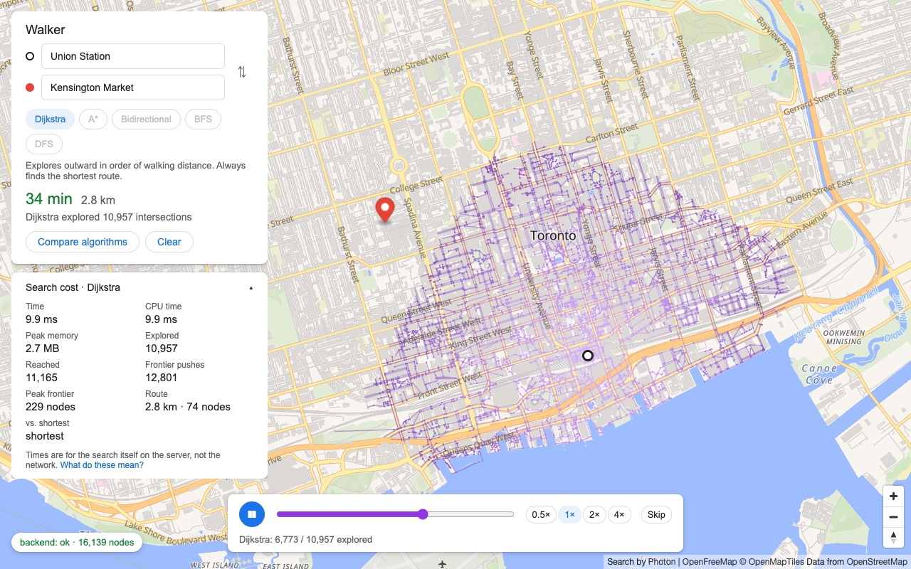
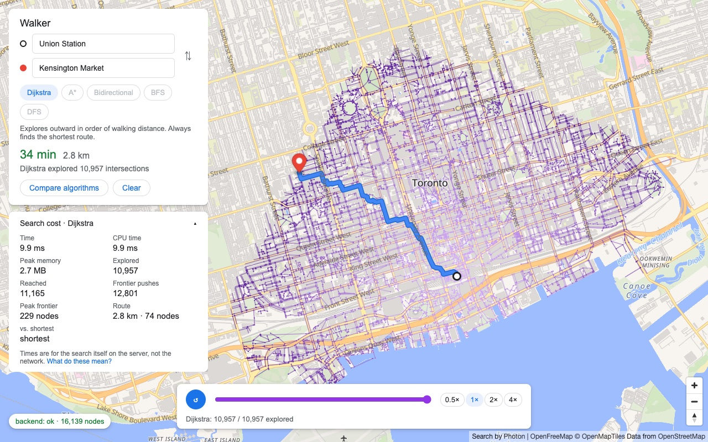

# Walker

A walking-only map of Toronto for exploring graph search. Instead of switching
between car, transit and walking, you switch between search algorithms and
watch how each one explores the street network.





- **Backend:** Python 3.12, Django, managed with [uv](https://docs.astral.sh/uv/).
- **Frontend:** React + TypeScript (Vite) with [MapLibre GL JS](https://maplibre.org/).
- **Map data:** © OpenStreetMap contributors. Tiles from [OpenFreeMap](https://openfreemap.org/), place search from [Photon](https://photon.komoot.io/).

## Running locally

You need `uv` and Node.js 22.22+ or 24.15+ (`.nvmrc` pins 24).

### Backend

```sh
cd backend
cp .env.example .env
uv sync
uv run python -m graph.build --area downtown   # one-time, downloads from OpenStreetMap
uv run python manage.py runserver
```

The build step downloads downtown Toronto's walkable streets and saves them to
`backend/data/downtown.walkgraph`. The server only ever reads that file; it
never contacts OpenStreetMap itself. Rerun the build to refresh the data.

Don't skip the `cp` step: without a `.env`, debug is off and Django refuses
to start until `DJANGO_SECRET_KEY` is set.

The API runs on http://127.0.0.1:8000. Check it with
`curl http://127.0.0.1:8000/api/health`.

### Frontend

In a second terminal:

```sh
cd frontend
npm install
npm run dev
```

Open http://localhost:5173. The dev server forwards `/api` requests to the
backend, so both must be running.

## Tests

```sh
cd backend && uv run pytest
cd frontend && npm test
```

`npm run build` type-checks and builds the frontend, and `npm run lint` lints it.

## Configuration

Settings come from environment variables. See `backend/.env.example` and
`frontend/.env.example`.

| Variable | Where | Purpose |
| --- | --- | --- |
| `DJANGO_DEBUG` | backend | Debug mode. Off unless set; `.env.example` turns it on. |
| `DJANGO_SECRET_KEY` | backend | Required when debug is off. |
| `DJANGO_ALLOWED_HOSTS` | backend | Comma-separated host names. |
| `WALKER_GRAPH_PATH` | backend | Graph file to serve. Relative paths are relative to `backend/`. Defaults to `data/downtown.walkgraph`. |
| `WALKER_GEOCODER` | backend | `photon`, or a dotted path to another geocoder class. |
| `WALKER_PHOTON_URL` | backend | Photon server. Defaults to the public one. |
| `WALKER_GEOCODE_RATE`, `WALKER_GEOCODE_RATE_WINDOW_S` | backend | Searches allowed per client per window (10 per 10 s). |
| `WALKER_GEOCODER_MAX_PER_S`, `WALKER_GEOCODER_BURST` | backend | Cap on requests sent to the geocoding provider, for the whole server (1 per second, bursts of 3). |
| `VITE_MAP_STYLE_URL` | frontend | Map style JSON; swap to change tile provider. |
| `VITE_API_PROXY_TARGET` | frontend | Where the dev server sends `/api`. |

## Using it

1. **Pick two points.** Type a place into the starting point and destination
   boxes and choose a suggestion, or click the map: the first click sets the
   start, the second the destination, and a third starts over. ⇅ swaps them.
   If a point isn't on a street, a dotted line joins it to where the route
   really starts.
2. **Watch the search.** Every street segment the algorithm reaches is drawn
   as it happens, light at first and darker later (the two halves of a
   bidirectional search in purple and orange). Pause, scrub, change speed or
   skip with the bar at the bottom. Explored streets are drawn as straight
   lines between intersections to keep the animation light. If your system
   is set to reduce motion, searches open already finished.
3. **Read the result.** When the search reaches the end, the walking route
   appears in blue with its time and distance, and the card under the
   directions shows what the search cost: time, memory, intersections
   explored, peak frontier size and how the route compares with the shortest.
4. **Compare.** Pick another algorithm from the chips to re-run the route
   with it, or press *Compare algorithms* to run them all: a table lists each
   one's route length, intersections explored and time, and the others'
   routes appear in grey on the map. The algorithms run one after another so
   their timings don't disturb each other.

## API

`POST /api/route`

```json
{"origin": {"lon": -79.3871, "lat": 43.6426},
 "destination": {"lon": -79.4005, "lat": 43.6547},
 "algorithm": "dijkstra"}
```

Each point snaps to the nearest walkable node within 300 m. The response holds
the route line (`route.coordinates`, as `[lon, lat]` pairs), its length and an
estimated walking time at 1.4 m/s, where each point snapped to, and how many
nodes the search visited. Errors are JSON with `error` and `code`:

| Status | `code` | Meaning |
| --- | --- | --- |
| 400 | `bad_request`, `unknown_algorithm` | Malformed body or unknown algorithm |
| 501 | `not_implemented` | The algorithm is still a stub |
| 422 | `outside_coverage` | A point is more than 300 m from any street on the map |
| 422 | `no_route` | The points aren't connected |
| 500 | `algorithm_error` | The algorithm crashed, broke the event rules, looped, or gave a different result when run again (details shown in debug mode) |
| 503 | `graph_unavailable` | No graph is loaded |

Every route also carries `metrics`, what the search cost:

| Field | Meaning |
| --- | --- |
| `wall_ms`, `cpu_ms` | Median time of the algorithm alone over `timing_runs` clean runs (up to 5, within about 0.3 s) |
| `peak_memory_bytes` | Most memory the algorithm's own allocations reached, from a separate run under `tracemalloc` |
| `visited` | Intersections taken off the frontier and expanded |
| `discovered` | Different intersections ever added to the frontier |
| `frontier_pushes` | Additions to the frontier, including improved routes to a node already there |
| `peak_frontier` | Most *different* intersections waiting on the frontier at once (both halves together for bidirectional). A heap or stack that keeps outdated duplicate entries holds more than this. |
| `path_nodes` | Intersections on the route |
| `optimal_distance_m`, `is_shortest`, `extra_distance_m`, `extra_distance_pct` | How the route compares with Dijkstra's shortest one. `is_shortest` uses a tiny tolerance for rounding, never percentage rounding, so a route 1 m too long is not called the shortest. |

Each measurement comes from its own pass, because measuring changes what is
measured: a checked run validates the algorithm and records the animation,
clean runs (nothing but the algorithm) give the timing, and a final run under
`tracemalloc`, which slows Python several times over, gives the memory.
Every repeat run must yield exactly as many events as the checked one, under
the same event cap and time limit; an algorithm that keeps state between runs
or uses randomness is reported as an error rather than given meaningless
numbers. Timing repeated requests for the same downtown route varies by about
1%. Measuring runs the search up to eight times (plus a Dijkstra run for the
shortest distance), so the results are cached per algorithm and route: the
first request for the longest downtown route (with its animation trace)
takes about 0.2 s, repeats
about 0.05 s. Measurements run one at a time per server process, so two
requests never time each other; memory figures are exact when no other
request is busy at the same moment (true for gunicorn sync workers).

Add `"trace": true` to get every step of the search for the animation, as
`trace: {coordinates, events, count, truncated}`. `coordinates` lists each
node the search touched once; `events` holds three numbers per step: what
happened (0 discover, 1 visit, 2 and 3 the same for the backward half of a
bidirectional search), the node's index in `coordinates`, and its parent's
index (-1 for none). The worst downtown case, Dijkstra from corner to corner,
is 34,531 steps: about 900 KB of JSON, 220 KB gzipped, built in under 0.1 s.
Traces over 200,000 steps are cut short and marked `truncated`.

`GET /api/geocode?q=CN%20Tower` suggests places on the map (up to 8, default
5) as `{name, address, lon, lat}`. It forwards to the configured geocoder
(Photon by default), caches answers for a day, allows each client 10
searches per 10 seconds and sends the provider at most about one request a
second (429 `rate_limited` beyond either; 503 `geocoder_unavailable` if the
provider is down, after which it isn't asked again for 30 seconds).

`GET /api/algorithms` lists the search algorithms and which are implemented.

`GET /api/health` reports whether a graph is loaded and its size.

## Search algorithms

What each algorithm does, and what to look for when it runs:

- **Dijkstra** keeps every reached intersection in a priority queue ordered
  by walking distance from the start and always explores the closest one
  next. It spreads out in rings by distance and always finds the shortest
  route, but explores everything closer than the goal in every direction.
- **A\*** is Dijkstra with a sense of direction: an intersection's priority
  is its distance so far plus the straight-line distance still to go. As long
  as that estimate never overshoots, the route is still the shortest, but the
  search narrows into a beam toward the goal and explores far less.
- **Bidirectional Dijkstra** runs one search from each end and stops once
  they have met and no shorter route can still exist. Two small circles cover
  much less than one big one. The tricky part is knowing when to stop: the
  first intersection both searches reach isn't always on the shortest route.
- **BFS** (breadth-first search) explores in rings of street *segments*,
  ignoring their length. It finds the route with the fewest segments, which
  on real streets is often longer to walk than Dijkstra's.
- **DFS** (depth-first search) follows one street as far as it can before
  backing up. It finds *a* route, usually a long and winding one, which is
  exactly what it shows.

On a graph with V intersections and E street segments, Dijkstra, A\* and
bidirectional Dijkstra take O((V + E) log V) time with a binary heap; BFS and
DFS take O(V + E).

### Status

| Algorithm | File | Returns | Status |
| --- | --- | --- | --- |
| Dijkstra | `dijkstra.py` | shortest route | done |
| A* | `astar.py` | shortest route | to do |
| Bidirectional Dijkstra | `bidirectional.py` | shortest route | to do |
| BFS | `bfs.py` | fewest street segments | to do |
| DFS | `dfs.py` | any route | to do |

Each algorithm lives in `backend/algorithms/` as a generator function that
yields events while it runs: `Discover` when a node joins the frontier,
`Visit` when it is explored, and a final `Done` with the path. The rules, with
worked examples, are in `backend/algorithms/events.py`. The runner checks
every event and the final path, so a mistake shows up as a clear error rather
than a wrong line on the map.

### Writing one

1. Open the algorithm's file. Its docstring says what it must return and what
   tends to go wrong; the function body is a stub that raises
   `NotImplementedError`.
2. Replace the stub with your implementation. Read `dijkstra.py` for how the
   events are reported.
3. Check it:

   ```sh
   cd backend
   uv run pytest tests/test_conformance.py -k bfs -v
   ```

   The conformance tests run it on small hand-built graphs (including traps
   for common mistakes), on random graphs and on real downtown routes, and
   compare the answer with NetworkX. Every test graph is drawn to scale at
   Toronto's latitude, with no edge shorter than a straight line, so a
   correct straight-line heuristic for A* is never penalised. While the stub is in place these tests
   are skipped.
4. Reload the page. The picker enables an algorithm as soon as it stops
   raising `NotImplementedError`; the dev server picks up the change on save,
   and the page asks for the list of algorithms when it loads.

`GET /api/algorithms` lists every algorithm and whether it is implemented.

## The graph

| Area | Nodes | Edges | File | Build | Load + index | Memory |
| --- | --- | --- | --- | --- | --- | --- |
| downtown | 16,139 | 43,914 | 1.1 MB | ~30 s (mostly download) | 0.2 s | ~4 MB |

Measured on 2026-10-09 on an Apple Silicon Mac. Edges are directed, so each
two-way street counts twice. Only the largest connected part of the network is
kept, so every node can reach every other node. Load time is mostly building
the reverse (incoming) edge lists and validating the file, both plain Python
loops; expect it to grow in proportion to the edge count as the area grows.

The graph is stored in compressed sparse row form: one array of node
coordinates, and for each node a slice of a shared array of outgoing edges.
See `backend/graph/graph.py`.

## Project layout

```
backend/
  config/     Django settings and URLs
  algorithms/ search algorithms and the runner that checks them
  geocoding/  place search providers (Photon), no Django imports
  graph/      the walkable graph: build from OSM, storage, nearest-node lookup
              (no Django imports)
  routing/    API views and the in-memory graph store
  tests/
frontend/
  src/        React app
```
